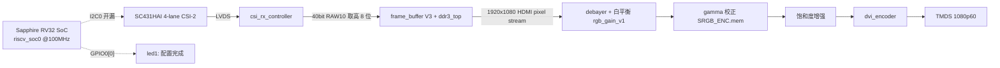

# fpga_src — Ti60F225 + SC431HAI 摄像头 → HDMI

## 快速执行

从工作区根目录运行 `tools/fpga-flow.sh`，或在本目录运行：

```sh
tools/build_all.sh --fpga-only          # 综合、布局布线并生成 bit/hex
tools/build_all.sh --fpga-only --program # 同上，并经 JTAG 临时下载，不写 Flash
python3 tools/board_smoke_test.py --port /dev/ttyUSB2 --json
```

模型资源预检：`python3 tools/st_480p10_preflight.py`。它只生成规划报告，
不会把 NNgen 专用流式 RTL 复制到板级工程；当前 480p/10fps 共享 DDR tile
引擎尚未完成。

在 Titanium **Ti60F225** 上实现：**MIPI CSI-2 摄像头采集 + DDR3 帧缓冲 + 图像处理 + HDMI 输出**，
并把**摄像头的 I2C 配置交给片上 RISC-V (Efinix Sapphire RV32 SoC)**。

参考工程（只参考这一个）：`../10_Ti60f225_sc431hai2hdmi_demo/Ti60f225_sc431hai2hdmi_v6`。
本次移植**引脚/外围完全沿用参考工程**（`fpga_src.peri.xml` 由 `ti60f225_oob.peri.xml` 直接改
`design_db name` 而来），所以板上接线、PLL、DDR3 PHY、MIPI RX/DSI LVDS、HDMI TMDS 全部一致。

---

## 1. 数据通路



| 环节 | 频率 | 说明 |
|---|---|---|
| `i_mipi_rx_pclk` | 50 MHz | CSI RX 像素时钟 |
| `core_clk` | 100 MHz | DDR3/DDR 逻辑 + **SoC 主频** |
| `vid_clk_dvi2` | 74.25 MHz | debayer/白平衡/gamma 域 |
| `hdmi_tx_slow_clk` | 148.5 MHz | 饱和度 + TMDS 编码，1080p60 |
| `sdram_clk` | 400 MHz | DDR3 |

输出时序为 CEA 1080p60（HFP/HSP/HBP = 88/44/148，VFP/VSP/VBP = 4/5/36）。

---

## 2. 目录

```
fpga_src.xml            工程文件（顶层 fpga_src，rtl/fpga_src_top.v）
fpga_src.peri.xml       Interface Designer 引脚/外围（沿用参考工程）
fpga_src.sdc            时序约束（沿用参考工程）
rtl/
  fpga_src_top.v        顶层：视频通路 + SoC 例化 + 引脚保持逻辑
  csi_rx_controller.sv  MIPI CSI-2 RX IP（加密核，参数在文件头明文）
  ddr3_controller/      软 DDR3 控制器 + 校准
  frame_buffer_V3/      DDR3 三帧缓冲（bank_switch / ddr_buffer / ...）
  debayer/              Bayer→RGB + 白平衡增益
  dvi_tx/               HDMI TMDS 编码器（加密核）
  gamma_conrrection/    gamma 校正 + 曲线 mem
  cam_i2c_ctrl/         【仅存档】原 FPGA 侧 I2C 寄存器表，现已不参与综合，
                        固件的寄存器表由它导出
ip/riscv_soc0/          无 IDE 生成的 Sapphire RV32 SoC（含片上 RAM 初始化 .bin）
embedded_sw/riscv_soc0/ BSP + 固件
  software/standalone/camera/cameraI2c/   本工程的固件（摄像头 I2C 初始化）
  camera_i2c.hex                          固件编译产物（嵌进 SoC 用）
tools/gen_ip.py         无 IDE 生成/重配 IP 的脚本
tools/build_all.sh      一键构建（固件 → SoC → bitstream）
```

---

## 3. 与参考工程的差异

**照搬**：整条视频通路 RTL、`peri.xml`、`sdc`、引脚、DDR3 参数、gamma 曲线用法。

**改动**：
1. 顶层改名 `fpga_src`，文件放 `rtl/fpga_src_top.v`（放在 `rtl/` 是为了
   `include "ddr3_controller/ddr3_parameter.vh"` 的相对路径与参考工程一致）。
2. **删除 JTAG debug core**（VIO / Logic Analyzer）。因此：
   - `gamma_sel`（原来自 VIO）改成 `localparam GAMMA_BYPASS`；
   - 参考工程里"VIO 写入不生效、白平衡只能硬编码"的问题不复存在；
   - 未使用的 JTAG/DSI 输入引脚由一段 `pin keep` 异或逻辑保留（否则综合会把
     无负载输入裁掉，PnR 报 `Required pin ... is not found`）。见
     `rtl/fpga_src_top.v` 中"未使用的外围输入引脚保持"一节。
3. **摄像头 I2C 上移到 RISC-V**：删掉 `i2c_master_ctrl_top` 及其 164 条 ROM 播放器，
   改为 Sapphire SoC 的 I2C0 直接驱动 `io_cam_scl/sda`，寄存器表搬进固件。
4. 增加 SoC 状态灯：`SoC GPIO0[0] -> led[1]`。

---

## 4. 工具链

| 工具 | 位置 | 说明 |
|---|---|---|
| Efinity 2026.1.132 | `/opt/efinity/2026.1`，`/usr/bin/efx_run` 等 | 已可命令行使用 |
| RISC-V GCC | `/opt/toolchains/xpack-riscv-none-elf-gcc-15.2.0-1/bin` | xPack `riscv-none-elf-gcc`（官方 RISC-V IDE 用的同一套），支持 rv32imc/ilp32 |

把工具链加进 PATH：

```sh
export PATH=/opt/toolchains/xpack-riscv-none-elf-gcc-15.2.0-1/bin:$PATH
```

**IP 不需要 IDE**：`tools/gen_ip.py` 直接调用 Efinity IP Manager 的 python API，
等价于 GUI 里"选 IP → 改参数 → Generate"。示例：

```sh
python3 tools/gen_ip.py --list
python3 tools/gen_ip.py --vlnv soc/efx_soc:3.4.0 --dump-params
```

---

## 5. 构建

```sh
# 全流程（固件 + SoC + FPGA），约 4 分钟
tools/build_all.sh

# 只改了 RTL：跳过固件和 IP 生成，约 2.5 分钟
tools/build_all.sh --fpga-only

# 改了固件但没改 SoC 配置
tools/build_all.sh --no-ip
```

只跑 FPGA 时等价于：

```sh
efx_run --prj fpga_src.xml -f compile --dir .
```

构建产物：

| 文件 | 用途 |
|---|---|
| `outflow/fpga_src.hex` | 烧 SPI flash，起始地址 `0x000000` |
| `outflow/fpga_src.bit` | JTAG 下载 |
| `embedded_sw/.../camera_i2c/build/camera_i2c.elf` | 固件调试用 |

> 本工程**只有一个比特流**：SoC 固件已经作为片上 RAM 初值编进 bitstream，
> 不需要像参考工程那样再单独烧一个 `0x380000` 的固件镜像。

构建参数：`max_threads=24`（`fpga_src.xml` 综合/PnR 两处）。

---

## 6. SoC（riscv_soc0）配置与接口

配置（`tools/build_all.sh` 里的 `SOC_PARAMS`，改完必须重跑 IP 生成）：

| 项 | 值 | 理由 |
|---|---|---|
| SOC_MODE | Standard | |
| Frequency | 100 MHz | 与 `core_clk` 同源 |
| DDR | 关 | 外部 DDR3 留给视频帧缓冲，SoC 用片上 RAM |
| OCRSize | 64 KB | 固件实测占 9.5 KB |
| I2C0 | 开 | 摄像头配置 |
| UART0 | 开 | 本板没空闲串口脚，暂未引出 |
| GPIO0 | 开（4 位） | 状态灯 + 预留按键 |
| SPI0/1/2 | 关 | 不需要 |
| AXISlave | 关 | 不接 AXI master |
| DEBUG | 关 | 不带 JTAG 调试核 |
| HexFile_Path | `embedded_sw/riscv_soc0/camera_i2c.hex` | Custom On-Chip RAM Application：直接跑固件，不跑 SPI bootloader |

顶层连接（`rtl/fpga_src_top.v`）：

```verilog
.io_systemClk              (core_clk)          // 100 MHz
.io_asyncReset             (~w_arstn)          // 所有 PLL 锁定后释放
.system_i2c_0_io_scl_read  (io_cam_scl_IN)
.system_i2c_0_io_scl_write (w_soc_i2c_scl_write)
.system_i2c_0_io_sda_read  (io_cam_sda_IN)
.system_i2c_0_io_sda_write (w_soc_i2c_sda_write)

// I2C 开漏：write=0 拉低，write=1 释放（靠总线/内部弱上拉）
assign io_cam_scl_OUT = 1'b0;
assign io_cam_scl_OE  = ~w_soc_i2c_scl_write;
assign io_cam_sda_OUT = 1'b0;
assign io_cam_sda_OE  = ~w_soc_i2c_sda_write;
```

极性依据：Efinity 自带示例 `ip/riscv_soc0/T120F324_devkit/top_soc.v` 的
`writeEnable = !write`，配合三态 GPIO 的 `OUT=0`，即开漏。

---

## 7. 固件（cameraI2c）

`embedded_sw/riscv_soc0/software/standalone/camera/cameraI2c/`

- `src/sc431hai_regs.h`：164 条寄存器表，**由 `rtl/cam_i2c_ctrl/i2c/i2c_master_reg_rom.v`
  自动导出**，顺序不可改（数据手册要求上电时序不能重排；其中 index 0 是
  `0x0100=0x00` 停流，index 0x90 是 `0x0100=0x01` 开流）。
- 设备地址：数据手册 1.4 节，PAD SID 低电平 → 7-bit `0x30` / 8-bit 写地址 `0x60`
  （与参考工程的 `I2C_DEVICE_ADDR=8'h60` 一致）。
- 报文格式：16-bit Sub Address（先高后低）+ 8-bit data，用 BSP 的
  `i2c_writeData_w()`。
- 跑完 164 条后把 GPIO0[0] 置 1 → 点亮 `led[1]`。

单独编译：

```sh
cd embedded_sw/riscv_soc0/software/standalone/camera/cameraI2c
make BSP=efinix/EfxSapphireSoc
```

> `BSP=efinix/EfxSapphireSoc` 必须传；IDE 会自动填，命令行要显式给。

---

## 8. 后续要加按键时

两条现成的路：

1. **SoC GPIO0**：4 位，`system_gpio_0_io_write/read/writeEnable`。
   顶层把要用的位接到板上按键脚（需要在 `fpga_src.peri.xml` 里给对应引脚
   加/改 GPIO 定义，用 Interface Designer 或在 peri.xml 里改 `comp_gpio`），
   固件用 `gpio_getInput()` 轮询或开中断（`gpio_setInterruptRiseEnable` 等）。
2. **APB3 从机 `io_apbSlave_0_*`**：SoC 已经引出 APB3 主机接口
   （基址 `0xf8010000` 起，`APBSlave0_Size=64KB`）。自己写一个 APB3 从机模块
   挂上去（参考 `ip/riscv_soc0/T120F324_devkit/top_soc.v` 里的 `apb3_slave` 例化），
   适合做按键消抖/状态寄存器这类"带寄存器映射"的逻辑，RPU 侧用
   `read_u32/write_u32` 访问。

当前顶层 APB 主机已被引出但**悬空**（`w_soc_apb_*` 未接从机，`PREADY=1`），
直接挂模块即可，不用改 SoC 配置。

---

## 9. 已知限制 / 未做

- **不是上个电就能看的成品**：本次交付到"综合/布局布线/bitstream 全过 + 时序收敛 +
  固件编译并嵌入"为止，**没有上板验证**（本机 `lsusb` 里没有 Efinix 下载器，
  也无法接摄像头/显示器）。
- 板上资源余量：XLR 52.4%（31873/60800）、Memory Block 65%（166/256）、DSP 9/160。
  片上 RAM 已占 64 KB（79 个 BRAM），再加大 SoC 空间要留意 Memory Block。
- UART0 已在 SoC 里使能但**未接引脚**（`rxd` 固定 1），所以固件里的
  `CAM_I2C_VERBOSE` 打开也看不到输出。
  （注意别和 §12 的**片上状态 UART** 搞混：那个是 FPGA 侧驱动 `GPIOR_28`
  → FT4232 通道 C，不是 SoC 的 UART0。）
- SoC **没有 JTAG 调试核**（`DEBUG=0`）。要用 OpenOCD 单步调试固件，需要
  重新生成 SoC（`DEBUG=1'b1`）并在 `peri.xml` 里加 JTAG 引脚，同时把顶层的
  `pin keep` 段让位给调试核的 TDO。
- `fpga_src/engine/` 是之前 conv-engine 实验留下的目录，与本工程无关，未改动。

---

## 10. 验证记录（本次）

| 项 | 结果 |
|---|---|
| `efx_run -f compile` | map/interface/pnr/pgm 全部 PASS，`last_run_state=pass` |
| 时序 | 最差 setup slack **+0.427 ns**（tx_cal_clk_90edge），hold 无需修复 |
| 资源 | XLR 52.42%、Memory Block 166/256、DSP 9/160 |
| 固件编译 | 9472 B / 64 KB（14.45%），`riscv-none-elf-gcc` rv32imc/ilp32 |
| 寄存器表一致性 | 固件 `.data` 里 656 B 表与参考工程 ROM **逐字节一致**（164 条） |
| SoC 片上 RAM 初值 | `ip/riscv_soc0/*_system_ramA_logic_ram_symbol*.bin` 随固件更新（md5 变化已确认） |

---

## 11. 和"用 IDE 的人"协作 / 怎么改 IP

### 11.1 IP 生成产物就是一套固定结构

`ip/riscv_soc0/` 与 IDE 生成的 `ip/<模块名>/` **逐项一致**（对照参考工程的
`ip/csi_rx_controller/`）：

```
<模块名>.v            生成出来的 HDL 源（SoC 是 SpinalHDL 生成的全部明文 Verilog）
<模块名>_define.vh    宏/地址定义
<模块名>_tmpl.v/.sv/.vhd   例化模板
settings.json         【核心】该 IP 的全部参数记录
ipm/component.pickle  IP Manager 内部缓存（重新配置时用）
ipm/graph.pickle
<器件>_devkit/        交付的示例工程（可以不管）
Testbench/            交付的仿真文件
```

参数**不在工程 XML 里**（`fpga_src.xml` 的 `<efx:ip_info/>` 是空的，参考工程也是空的），
而在每个 IP 自己的 `settings.json` 里。我们的 SoC 那份记了 **152 项**参数：

```json
{ "args": [ ..., {"name":"efx_soc","version":"3.4.0"} ],
  "conf": { "DDR": "1'b0", "OCRSize": "65536", "I2C0": "1'b1",
            "HexFile_PathEnable": "1'b1",
            "HexFile_Path": "embedded_sw/riscv_soc0/camera_i2c.hex", ... } }
```

另外，**引脚/PLL/DDR PHY/LVDS 这些"硬"配置不在 IP 里**，在
`fpga_src.peri.xml`（Interface Designer）。那个才相当于"CubeMX 的单个工程配置文件"。

### 11.2 改 IP 的正确方式（IDE 用户）

生成的 `.v` **不要手改**（下次 Generate 会被覆盖，而且 Efinity 官方明确说
不要手工把 IP 的 .v 加进工程）。正确姿势：

- IDE：Project 面板右键 `ip` 目录 → **Import IP** → 选 `settings.json`
  → 向导带着现有参数打开 → 改 → Generate。
- 命令行（本工程用的方式）：

  ```sh
  python3 tools/gen_ip.py --vlnv soc/efx_soc:3.4.0 --dump-params   # 看参数
  # 改 tools/build_all.sh 里的 SOC_PARAMS 然后：
  tools/build_all.sh
  ```

两条路走的是**同一个 IP Manager API**，改完都会重写 `settings.json`，所以能互相接管。

### 11.3 哪些是加密的（改不了内部逻辑）

| 文件 | 加密比例 | 说明 |
|---|---|---|
| `rtl/csi_rx_controller.sv` | 20 块，约 73% 行 | MIPI CSI-2 RX 核，只有参数和端口是明文 |
| `rtl/dvi_tx/dvi_encoder.v_encrypted.v` | 1 块，约 87% | TMDS 编码核 |
| `ip/riscv_soc0/riscv_soc0.v` | **2 块，约 1%** | SoC 基本全是明文 Verilog（只有 `EfxCPUSp1/Sp2` 两个小块受保护） |

所以 SoC 侧想看懂/改内部实现是可行的，MIPI/HDMI 核只能改参数。

### 11.4 本工程与"纯 IDE 流程"的两点差异

1. **生成的 `.v` 直接放在 `ip/` 下并写进 `design_file` 列表。**
   参考工程的习惯是把 IP 的 .v 拷到 `rtl/` 再手工维护。放在 `ip/` 更符合
   Efinity 的组织方式，IDE 会把它当 IP 实例显示；重新 Generate 会自动生效。
2. **`HexFile_Path` 用项目内相对路径**（`embedded_sw/riscv_soc0/camera_i2c.hex`），
   不是绝对路径 —— 保证 clone 到别人机器上重新生成 IP 时路径仍然有效。

---

## 12. 板载状态 UART（led[2] 其实是串口）

### 12.1 硬件事实

`peri.xml` 里叫 `led[2]` 的 **`GPIOR_28` 根本没接 LED**，它接的是板载 FT4232HL
通道 C 的 **RXD**：

```
GPIOR_28 (球号 R14) -- R243 33R -- UART_RX_3V3 -- FT4232HL CDBUS1 (RXD)
GPIOL_02 (球号 N3)  -- R242 33R -- UART_TX_3V3 -- FT4232HL CDBUS0 (TXD)  ← FPGA 未用
```

依据是 `Ti60F225A_V4_SCH.pdf` sheet7 与 `outflow/fpga_src.pinout.csv` 的
**7/7 球号一一对应**：

| 球号 | peri 里的名字 | 原理图网络 |
|---|---|---|
| N14 | `led[0]` | LED0 |
| P14 | `led[1]` | LED1 |
| P15 | `led[3]` | LED3 |
| P13 | `i_arstn` | KEY1 |
| R14 | **`led[2]`** | **`UART_RX_3V3`** |
| R13 | （未用） | CLK_50M |

所以板上只有 LED0/LED1/LED3 三个灯；原代码 `assign led[3:2] = 2'b00;`
实际是把 FTDI 的 RXD 拉死在低电平。

四个 FTDI 通道对应 `/dev/ttyUSB0..3`（接口 00..03）：**通道 C = `/dev/ttyUSB2`**。
（通道 B 是 JTAG，`efx_run` 编程用的就是它，别去占用。）

### 12.2 怎么用

`rtl/fpga_src_top.v` 里把 `DBG_UART_EN` 改成 `1'b1` 重新编译即可
（默认 `1'b0`，综合会整块裁掉，见 12.4 的代价）：

```sh
tools/build_all.sh --rtl-only && efx_run --prj fpga_src.xml -f program --pgm_opts mode=jtag --dir .
python3 -c "
import serial,time
s=serial.Serial('/dev/ttyUSB2',115200,timeout=0.2); s.reset_input_buffer()
t0=time.time(); b=b''
while time.time()-t0<4: b+=s.read(4096)
open('/tmp/st.bin','wb').write(b); print(len(b))"
```

115200 8N1，每 **0.5 s** 一帧 **28 字节**：

```
AA 55 | D[4] H[4] V[4] | SH[2] XH[2] | R | SEQ | ST_TILES[4] | ST_BUSY | RSV[3]
```

| 字段 | 含义 | 标称值（1080p60 正常） |
|---|---|---|
| `D` | `enc_de` 上升沿 / s | **64800** = 1080 行 × 60 fps |
| `H` | `enc_hs` 上升沿 / s | **67500** = 1125 行 × 60 fps |
| `V` | `enc_vs` 上升沿 / s | **60.0** |
| `SH` | `hdmi_tx_slow_clk` 心跳 / 0.5s | **567** ⇒ 148.5 MHz |
| `XH` | `vid_clk_dvi2` 心跳 / 0.5s | **283** ⇒ 74.25 MHz |
| `R` | `{w_arstn, cal_done, vid_rst_n, SoC_GPIO0[0]}` | **0x0F** |
| `SEQ` | 帧序号 | 连续递增 |
| `ST_TILES` | 已完成的 16×16 推理 tile 数 | 持续递增 |
| `ST_BUSY` | 推理管线忙 | 运行期间通常为 1 |

心跳算法是各自时钟域内每 2¹⁶ 周期翻转一次，core_clk 侧 2-FF 同步后数沿：
`148.5e6 / 2¹⁷ = 1132.9 Hz` → 每 0.5 s 上升沿 566.5 次（实测 567）。
**心跳停了 = 那个时钟停了**；`D/H/V` 不对 = 时序产生器有问题。

CDC 约定：所有要被 `core_clk` 采样的计数一律在 `core_clk` 域产生、跨域信号走
2-FF 同步，否则时序报告里会多出 `-1.193 ns` 的假违例（踩过）。

### 12.3 2026-10-11 上板实测

```
D=64800/s  H=67500/s  V=60.0/s  SH=567  XH=283  R=0x0F  SEQ 连续
```

即：全 PLL 锁定、DDR 校准完成、视频复位释放、**SoC 已完成摄像头 I2C 配置**、
TMDS 像素钟 148.5 MHz、视频钟 74.25 MHz、编码器收到的正是标准 CEA-1080p60。
**FPGA 侧输出链路全部正常。**

### 12.4 为什么默认关掉

`DBG_UART_EN=1` 时诊断逻辑会把 DDR 命令 FIFO 的 `raddr→CE` 挤出
**10 条 -0.054 ~ -0.006 ns 负 slack**；关掉后全部回到正。整块逻辑一裁，
时序只剩 1 条 `st_vid_pipe/cap_tog_vid→cap_tog_sync` 的 CDC 假路径（原设计就有）。
所以**交付基线是 0**，现场排障时再临时打开。

---

## 13. HDMI 采集卡排障记录（2026-10-11）

现象：接显示器正常，接 **MS2109 采集卡（534d:2109）** 只有采集卡自身的默认彩条。

### 13.1 已证实正常（FPGA 侧，§12 上板实测）

| 项 | 证据 |
|---|---|
| 时序 | `D=64800/s`、`H=67500/s`、`V=60.0/s` ⇒ 1080 行 ×60、1125 行 ×60，标准 CEA-1080p60 |
| 时钟 | `SH=567` ⇒ 148.5 MHz；`XH=283` ⇒ 74.25 MHz；PLL `CLK_27M×2×55=2970 MHz`，`/20 /40 /4` = 148.5/74.25/742.5，与 SDC 6.734/13.468/1.347 ns 一致 |
| 复位/外设 | `R=0x0F`：全 PLL 锁定、DDR 校准完成、视频复位释放、SoC 完成摄像头 I2C 配置 |
| TMDS 发送 | `TX_OE=1'b1` 常使能、`PCR_LVDSOE_SEL=CORE`、`PCR_LVDSTX_EN=ENABLE`、`serial_width=10` + `is_half_rate` |
| 外围配置 | `peri.xml` 与参考工程一致（`pre_emphasis=medium low`，`vod` 按参考取 large/typical） |

### 13.2 已排除

| 试过的变量 | 结果 |
|---|---|
| 电气驱动强度（实验A/C）：四 lane `vod=large` + `pre_emphasis=high`，与厂商参数各测一轮 | 采集卡输出 **md5 不变** |
| TMDS 速率（实验B）：480p / 720p / 1080p | 采集卡输出 **md5 不变** |
| AVI `video_VIC`：0 / 4 / 16 | 采集卡输出 **md5 不变** |
| 本地测试图案 `TP_EN=1`（256 px 分界） | 采集卡仍是 240 px 彩条，**逐字节相同** |

⇒ **MS2109 没锁到任何 TMDS**，不是"锁到了但模式不对"。FPGA 在正常吐标准 1080p60。

### 13.3 待现场确认（FPGA 侧无法判断）

板底丝印有两个 HDMI 口：**`TX`(U17)** 和 **`RX`(U15)**。TX 口的 HPD / DDC / +5V
都**没有进 FPGA**，插在 RX 口的设备也驱动不出任何 FPGA 可读的信号，所以只能上手测：

1. 采集卡插的是 **TX 还是 RX** 口（"显示器有、采集卡没有"与"插错到 RX"完全吻合）
2. 把**显示器那根线原样**换到采集卡上（同口同线，排除线/头）
3. 万用表量 **TX 口 pin18 有没有 5V**（`VCC_5V` → 磁珠 L8 → `VCC_5V_TX`，磁珠开路就会是"显示器认、采集卡不认"）
4. 用 PC 的 HDMI 输出喂一次采集卡，排除卡本身和它的线

若确认是插错口，可把 TMDS 镜像到 RX 口（用 RX 口的 `HDMI_RX_5V_N0` 检测做门控，
避免与外部信源对打）—— 未确认前不要驱动那 4 对差分线。

---

## 14. 主线开发与板上自动验收

HDMI 采集卡不作为 RTL 回归的必要条件。主线开发使用 JTAG 临时下载、板载
UART 遥测和仿真三层验证；JTAG 下载不会修改 SPI Flash。

```sh
# RTL 修改后的最快流程：综合/P&R/bitstream，然后临时下载到板上
tools/build_all.sh --fpga-only --program

# 读取板载 FT4232 通道 C 的状态帧；返回非零表示板上状态不合格
python3 tools/board_smoke_test.py --port /dev/ttyUSB2 --json
```

`board_smoke_test.py` 检查 PLL、DDR 校准、视频复位、摄像头 I2C 完成标志，以及
DE/HS/VS、每行 DE 宽度、两个视频时钟心跳和 ST tile 推进。输出是一行 JSON，适合 CI 或 agent 直接解析：

```json
{"ok":true,"frames":5,"latest":{"de":64800,"hs":67500,"vs":60,"slow_hb":567,"video_hb":283,"status":15,"seq":4,"st_tiles":1139,"st_busy":true}}
```

当前运行版本打开 UART 遥测以验证 ST tile 完成计数；它用于 JTAG 调试版，不能
作为最终时序基线。`DBG_UART_EN=1` 曾让 DDR FIFO 路径出现约 0.05ns 负 slack；
完成遥测后恢复到 `1'b0` 并重新综合，再作为 release bitstream。不要把 debug
bitstream 烧入 Flash。

最近一次 JTAG 下载后的实测为 `DE_WIDTH=1293` 个 core_clk 周期，即约 1920 个
HDMI 像素时钟；`ΔST=4`/0.5s，说明推理管线持续完成 tile。此前顶层误用
`MAX_HRES/2`，只按 960 个有效周期采样，已经改为 `MAX_HRES`。输出缓存首样本
的额外读延迟也已在 `st_vid_pipe` 中补齐，离线仿真验证了每个 tile 的输出序列。

Efinity 也支持通过 JTAG 插入片上 Logic Analyzer/Virtual I/O。当前 release 为了
资源和时序将 SoC `DEBUG=1'b0` 且未插入 debug core；若遇到偶发的 MIPI/DDR 问题，
应建立独立的 `ila` debug 配置，在 `core_clk`、`vid_clk_dvi2`、
`hdmi_tx_slow_clk` 三个时钟域分别抓取错误计数、FIFO 状态和帧边界。这样不会把
调试逻辑带回正常交付配置。

## 15. ST 加速器方向（480p / 10 fps）

当前 `ink_dw` 基线、Ti60 资源约束和建议的共享 MAC + tile 调度架构见
[`docs/st_accel_architecture.md`](docs/st_accel_architecture.md)。nngen `st-stream` 的
真实模型逐层折叠配置位于 `../nngen/examples/st_stream/configs/ink_dw_480p10.json`；
它用于周期/DSP探索，当前全网静态行缓存仍超出板上 RAM，尚不能直接下载。

## 16. 离线质检门

RTL 改动先运行统一质检门；它不需要开发板，且不会下载或修改 Flash：

```sh
tools/quality_gate.sh all       # 生成文件、几何、RTL、lint、协议仿真、Yosys
tools/quality_gate.sh synth     # 以上检查 + Efinity 综合/P&R/bitstream
QUALITY_GATE_EFINITY=1 tools/quality_gate.sh all
```

单项检查也可独立执行：`manifest`、`geometry`、`rtl`、`sim`、`formal`。仿真使用
缩小参数驱动四个 tile，验证输入三通道写入顺序、加速器启动/完成握手、输出复制
计数和拼接缓存地址边界。日志保存在 `/tmp/fpga-quality-gate`。只有质检门通过后
才建议执行 `tools/build_all.sh --fpga-only --program`；program 仍是显式操作。
