# 风格迁移网络：结构、参数量与对比分析

2026-11-03。对应赛题"超轻量化网络自设计"：

- 网络结构图；
- 参数量统计表；
- 与标准网络（简化版 CycleGAN）在画质（PSNR/SSIM）和推理延迟上的对比。

**部署网络（最终版）**：`tiny_dw_guided` 的 3 风格版本 `fpga_st_train/runs/astra2/final_s3b`。风格是 0 bright、1 gouache、2 comic，带 packet_guide 结构（§2.3）。
W8A8 导出在 `st_work/s3b/w8a8`。卷积结构和通道数与 prune90 `ln` 版本（`st_work/p90_ln_w8a8`）相同，所以 §3 的逐层参数和 MAC 表仍然适用。

**板上实现**：分支 feat/st-fmax（dad8cb8，已写入 SPI Flash），用户逻辑跑在 125 MHz。
设计见 docs/st-guided-adr.md，多风格部署见 docs/st-multistyle-deploy.md 第 8 节，资源见 docs/st-resource-report.md。

**复现**：所有数字都能用文末的命令复现。测试图是 6 张 demo 图（animal、cat、city、landscape、portrait、water）。

**各节数据的出处**：§4.2 对教师的 PSNR/SSIM 和 §4.3 的 CPU 延迟是在单风格 prune90 版本上测的（教师是 White-box）。
最终版各风格对 fp32 的保真度见 §2.3，对各自教师的 PSNR 还没有重新测。

## 1. 结论一览

| 指标 | 本网络 | 简化版 CycleGAN（ResNet-6） | CycleGAN（ResNet-9） | 教师 White-box（CVPR20） |
|---|---|---|---|---|
| 参数量 | **33,569**（3 个风格；共享 29,171，每个风格 1,466） | 7,837,699 | 11,378,179 | 1,467,132 |
| 参数存储（fp32） | 134 KB | 31.4 MB | 45.5 MB | 5.9 MB |
| 部署存储（W8A8，见 §3） | **约 39 KB**（3 个风格） | 约 7.8 MB | 约 11.4 MB | 约 1.5 MB |
| 计算量 @640×360 | **0.59 GMAC** | 123.2 GMAC | 174.2 GMAC | 28.8 GMAC |
| 对教师 PSNR / SSIM（板上数据通路，单风格 prune90） | **30.2 dB / 0.908** | 未训练，见 §4.2 | 未训练 | 参考（∞ / 1） |
| FPGA 推理延迟（Ti60F225） | **59.4 ms/帧，实测 16.8 fps（125 MHz）** | 放不下；按同一引擎峰值折算 ≥ 7.7 s | ≥ 10.9 s | ≥ 1.8 s |
| CPU 延迟（Ryzen 9 5900X，ORT，单线程） | 26.8 ms | 2695 ms | 3695 ms | 688 ms |

3 个风格加起来，fp32 参数存储约是 500 KB 上限的 1/4，部署形态约 39 KB。
和简化版 CycleGAN 相比，参数少约 230 倍，计算量少 208 倍。
单风格 prune90 版本在整条板上数据通路（RGB565 输入、整数网络、565 输出抖动）下，对教师的 PSNR 为 30.2 dB、SSIM 为 0.908。

## 2. 网络结构

### 2.1 结构图

```mermaid
flowchart LR
    IN["输入 RGB<br/>640×360（H）"] --> G["guide<br/>3×3 conv 3→8<br/>+ 每风格逐通道仿射"]
    IN --> P["avg_pool 2×2<br/>320×180（H/2）"]
    P --> HG["h2_guide 3×3 conv 3→10"] --> HP["h2_proj 1×1 10→40"]
    P --> S["stem 3×3 conv 3→16"]
    S --> E0["enc0: DW 3×3 s2 + PW 16→80<br/>160×90（H/4）"]
    E0 --> E1["enc1: DW + PW 80→80"]
    E1 --> R1["res: DW + PW 80→80"] --> R2["res: DW + PW 80→80"]
    E1 -- 残差 --> ADD1(("+"))
    R2 --> ADD1
    ADD1 --> LN["LayerNorm（逐像素，通道上）"]
    LN --> D4["dec_h4: DW + PW 80→24"]
    D4 --> U1["最近邻 2× 上采样"] --> D2["dec_h2: DW + PW 24→40<br/>H/2"]
    D2 --> ADD2(("+"))
    HP --> ADD2
    ADD2 --> FILM["FiLM<br/>GAP → MLP 40→10→(γ,β)×40"]
    FILM --> TG["to_guide 1×1 40→8"] --> U2["最近邻 2× 上采样"]
    U2 --> ADD3(("+"))
    G --> ADD3
    ADD3 --> HD["head: DW 3×3 + PW 8→3"] --> OUT["输出 RGB u8<br/>640×360 → 2×2 复制到 1280×720"]
```



纯文本版（报告排版可以按这个重画）：

```
          ┌──────────────────────── guide 3x3 3→8 ─────────────────────────────┐ H
 RGB H ───┤                                                                     (+)─ head DW+PW 8→3 ─ RGB
          └─ pool2x ─┬─ h2_guide 3x3 3→10 ─ h2_proj 1x1 10→40 ──┐ H/2           │
                     │                                           (+)─ FiLM ─ to_guide 40→8 ─ up2x
                     └─ stem 3x3 3→16 ─ enc0 DW s2+PW 16→80 ─ enc1 DW+PW 80 ─┬─ [DW+PW 80]x2 ─(+)─ LN
                                                                             └──────────────────┘   H/4
                                         LN ─ dec_h4 DW+PW 80→24 ─ up2x ─ dec_h2 DW+PW 24→40 ─┘(到上面的 +)
```

除 head.pw、res 第二个 PW、h2_proj 以外，每个卷积后面都接 ReLU。

### 2.2 设计思路

1. **三级分辨率，计算集中在 H/4**：
   - 80 通道的主干放在 160×90 上，用来学风格的颜色和笔触，约占 62% 的计算量。
   - H/2（10 通道）和 H（8 通道）两条引导分支直接从输入取边缘和细节，在解码端用加法注入。
   - 所以高分辨率部分很便宜：全分辨率上只有 3→8 的 guide 和 8→3 的 head。
2. **深度可分离卷积**：主干的 3×3 全部是 DW + PW 1×1。
   同样感受野下，参数和计算约是普通 3×3 卷积的 1/9 到 1/8。
3. **LayerNorm 代替 InstanceNorm**：
   - InstanceNorm 要整帧的均值和方差，硬件上得先统计一遍再归一化。
   - LayerNorm 在每个像素上沿通道做，可以流式计算。
   - 训练对比中 ln 和 in 两条臂画质相当（prune90 后 ln 31.2 dB，in 30.1 dB）。
4. **FiLM 全局调制**：
   - 在 H/2 上做全局平均池化（GAP），经 40→10→80 的小 MLP 得到每个通道的 γ、β。
   - 这给了网络一个"看整幅画面"的入口，用于整体色调和对比度。
   - 硬件上 GAP 在写 DDR 时顺路累加，不需要多一遍读。
   - FiLM、LN 和 guide 仿射是多风格切换时每个风格需要换的全部参数（每个风格约 2.4 KB，见 §2.3）。
5. **输入池化**：主干和 H/2 分支吃 2×2 平均池化后的输入，只有 guide 读全分辨率。
6. **蒸馏加剪枝**：
   - 以 White-box Cartoonization 为教师，在 COCO 上做蒸馏（像素、梯度、平坦区、笔触、线条等损失）。
   - 先训练较宽的网络：45,183 参数，1144.6 MMAC @640×480。
   - 按通道重要性分数剪到 90% 档：base/trunk/up_h4/up_h2/h2_guide/guide 从 32/96/32/48/16/8 降到 16/80/24/40/10/8，即 30,621 参数、783.5 MMAC @640×480。
   - 再微调 2000 步。
7. **为硬件定的整数化**：
   - 权重按通道 int8，激活按张量 int8（零点为 0）。
   - LN 的 1/√D 用 768 项 LUT 加移位实现，不需要除法器。
   - FiLM 的 MLP 用整数 MAC。
   - 这些整数定义相对 fp32 最多损失 0.08 dB（docs/st-guided-adr.md）。

### 2.3 多风格：风格包和 packet_guide

最终版一个网络带 3 个风格。所有卷积共享，每个风格只有一个"风格包"：

| 风格包内容 | 参数量 | 作用 |
|---|---|---|
| 主干 LayerNorm 的 γ、β | 160 | 主干的整体统计 |
| H/2 FiLM 的 MLP（40→10→80） | 1,290 | 按画面全局内容调色调和对比度 |
| guide 的逐通道仿射 g_s、b_s（packet_guide） | 16 | 每个风格自己调全分辨率细节分支的强弱 |
| **合计** | **1,466** | int8/定点形态约 2.4 KB |

**packet_guide**：guide 分支的输出改成 `relu(guide_conv(x) · g_s + b_s)`，g_s = exp(log_gain_s) > 0。
因为 g_s > 0，仿射可以折进卷积：权重变成 W·g_s，偏置变成 b·g_s + b_s。
按通道 int8 量化时，权重乘一个正的逐通道系数，int8 码不变，只有这个通道的 scale 变了。所以：

- 3 个风格的卷积权重（28,334 B）完全一样，片上只存一份；
- guide 层每个风格只多 8 个 requant 字（新的 scale 和偏置），放在已有的 rq ROM 里；
- 推理时没有额外的乘加，帧率和单风格一样。

**量化**：卷积和 requant 共享，所以各风格必须用同一套激活 scale。做法是逐点取各风格校准结果的最大值（联合校准）。
各风格因此比单独校准低 0.2–1.2 dB（对 fp32；bright 1.2、gouache 0.6、comic 0.2），这是多风格共享卷积的代价。

**硬件输出对 fp32 的保真度**（`st_guided.py`，与 RTL 逐位一致，6 张图的范围）：

| 风格 | 硬件对 fp32 | 训练端 int 推理对 fp32 |
|---|---|---|
| 0 bright | 34.9–38.6 dB | 34.9–38.5 dB |
| 1 gouache | 36.4–39.1 dB | 36.4–39.0 dB |
| 2 comic | 31.8–37.0 dB | 31.9–37.0 dB |

硬件和训练端的整数推理基本一致，硬件化没有带来额外损失。comic 偏低是这个风格量化以后的特性。

## 3. 参数量统计表

输入 640×360；MAC 按每个卷积自己的输出网格计算（上采样之前）。由 `tools/st_net_baselines.py` 从 manifest 统计。

| 层 | 类型 | Cin | Cout | 核 | 步长 | 输出尺寸 | 参数量 | MMAC |
|---|---|---|---|---|---|---|---|---|
| stem | conv + ReLU | 3 | 16 | 3×3 | 1 | 320×180 | 448 | 24.88 |
| enc0.dw | DW + ReLU | 16 | 16 | 3×3 | 2 | 160×90 | 160 | 2.07 |
| enc0.pw | PW + ReLU | 16 | 80 | 1×1 | 1 | 160×90 | 1,360 | 18.43 |
| enc1.dw | DW + ReLU | 80 | 80 | 3×3 | 1 | 160×90 | 800 | 10.37 |
| enc1.pw | PW + ReLU | 80 | 80 | 1×1 | 1 | 160×90 | 6,480 | 92.16 |
| res0.s1.dw | DW + ReLU | 80 | 80 | 3×3 | 1 | 160×90 | 800 | 10.37 |
| res0.s1.pw | PW + ReLU | 80 | 80 | 1×1 | 1 | 160×90 | 6,480 | 92.16 |
| res0.s2.dw | DW + ReLU | 80 | 80 | 3×3 | 1 | 160×90 | 800 | 10.37 |
| res0.s2.pw | PW（+ 残差） | 80 | 80 | 1×1 | 1 | 160×90 | 6,480 | 92.16 |
| trunk.ln | LayerNorm | 80 | 80 | – | – | 160×90 | 160 | 1.15 |
| dec_h4.dw | DW + ReLU | 80 | 80 | 3×3 | 1 | 160×90 | 800 | 10.37 |
| dec_h4.pw | PW + ReLU | 80 | 24 | 1×1 | 1 | 160×90 | 1,944 | 27.65 |
| dec_h2.dw | DW + ReLU（2× 上采样后） | 24 | 24 | 3×3 | 1 | 320×180 | 240 | 12.44 |
| dec_h2.pw | PW + ReLU | 24 | 40 | 1×1 | 1 | 320×180 | 1,000 | 55.30 |
| h2_guide | conv + ReLU | 3 | 10 | 3×3 | 1 | 320×180 | 280 | 15.55 |
| h2_proj | PW（+ 相加） | 10 | 40 | 1×1 | 1 | 320×180 | 440 | 23.04 |
| film_h2 | GAP + MLP 40→10→80 + 仿射 | 40 | 40 | – | – | 320×180 | 1,290 | 2.31 |
| to_guide | PW + ReLU | 40 | 8 | 1×1 | 1 | 320×180 | 328 | 18.43 |
| guide | conv + ReLU | 3 | 8 | 3×3 | 1 | 640×360 | 224 | 49.77 |
| head.dw | DW + ReLU（2× 上采样、相加后） | 8 | 8 | 3×3 | 1 | 640×360 | 80 | 16.59 |
| head.pw | PW → u8 | 8 | 3 | 1×1 | 1 | 640×360 | 27 | 5.53 |
| **合计（单风格）** | | | | | | | **30,621** | **591.1** |
| 另 2 个风格的风格包（trunk.ln、film_h2、guide 仿射） | | | | | | | 2 × 1,466 | – |
| guide 仿射（第 1 个风格） | | | | | | | 16 | 0（折进 guide） |
| **合计（3 个风格）** | | | | | | | **33,569** | **591.1** |

按分辨率分组：

| 分辨率 | 参数量 | MMAC | 占比 |
|---|---|---|---|
| H/4（160×90，主干） | 26,264 | 367.3 | 62% |
| H/2（320×180） | 4,026 | 151.9 | 26% |
| H（640×360） | 331 | 71.9 | 12% |

（按每层的输出网格分组：H/4 组从步长 2 的 enc0.dw 到 dec_h4，包括 LN；H/2 组包括 stem、h2 引导分支、dec_h2、FiLM 和 to_guide。）

存储：

- fp32：33,569 × 4 B = 134.3 KB（3 个风格）。
- 部署形态：
  - 卷积权重 int8 共 28,334 B，3 个风格共用；
  - 837 个偏置 int32 共 3,348 B，加上另 2 个风格的 guide 偏置 64 B；
  - 每个风格的 LN 和 FiLM 系数约 2.4 KB；
  - 合计**约 39 KB**。
- 都远低于 500 KB。

片上占用：PW 权重 ROM 26 个 RAM10，DW 权重 ROM 15 个，两套 rq ROM 各 9 个，3 个风格的 FiLM ROM 共 6 个，全部常驻片上，推理时不从 DDR 读权重（docs/st-resource-report.md）。

## 4. 与标准网络对比

### 4.1 对比对象

- **简化版 CycleGAN**：
  - pytorch-CycleGAN-and-pix2pix 的 ResNet 生成器，ngf=64，InstanceNorm，反射补边。
  - `resnet_6blocks`（官方用于小分辨率的简化配置）记为 R6，`resnet_9blocks`（标准配置）记为 R9。
  - 结构是 7×7 卷积，两次步长 2 下采样，6 或 9 个残差块，两次转置卷积上采样，再接 7×7 卷积。
- **教师网络**：
  - White-box Cartoonization（Wang & Yu，CVPR 2020），U-Net 生成器加引导滤波，GAN 训练。
  - 它是本网络的蒸馏目标，也是画质的参考。

### 4.2 画质（PSNR / SSIM，以教师输出为参考）

SSIM 按 Wang 2004 计算：11 抽头高斯窗，σ=1.5，K1=0.01，K2=0.03，取 RGB 三通道的均值。

**训练评测分辨率 640×427**（教师输出就是训练用的目标图）：

| 本网络 | PSNR dB | SSIM |
|---|---|---|
| fp32 | 31.21 | 0.930 |
| W8A8 整数参考（intref） | 30.36 | 0.916 |

**部署分辨率 640×360**（教师在 CPU 上用 ONNX Runtime 跑同一输入）：

| 本网络的数据通路 | PSNR dB | SSIM |
|---|---|---|
| fp32 | 31.01 | 0.929 |
| W8A8 整数参考（intref） | 30.05 | 0.916 |
| 硬件整数定义（与 RTL 逐位一致的 golden，`st_guided.py`） | 30.04 | 0.916 |
| 板上完整通路：1280×720 RGB565 输入 → 2×2 box → 网络 → 2×2 复制 + 565 抖动（2×2 平均后比较） | 30.18 | 0.908 |

逐张图的 PSNR 在 26.7（water）到 36.4 dB（animal）之间，纹理复杂的图（city、water）较低。

量化和硬件化带来的损失：

- 硬件输出相对 fp32 为 38.8 dB、SSIM 0.978。
- 对教师的 PSNR 从 31.0 降到 30.0 dB，其中几乎全部来自 W8A8 量化。
- 硬件的整数 LN/FiLM 只比 intref 多损失 0.01 dB。

**CycleGAN 的画质**：目前没有在同一任务上训练过 CycleGAN，所以表中没有它的 PSNR/SSIM。要公平对比，应该用同样的教师伪标签和同样的损失蒸馏一个 CycleGAN-R6 生成器，再用上面的脚本和参考图评测。这一项等 GPU 服务器到位后补上。

说明：

- CycleGAN 原本是非配对训练，它的输出和任意一个参考图的 PSNR 都不能直接反映风格化质量。
- 所以把"对教师的保真度"作为统一指标，比较各网络在同一风格目标下离教师有多远。教师本身就是 1.47M 参数、28.8 GMAC 的标准规模 GAN 生成器。

### 4.3 推理延迟

**FPGA（Ti60F225，sys_clk 125 MHz，DDR 控制器内核 100 MHz）**：

- 最终版实测每帧约 7.42M 周期，即 59.4 ms，板上 16.8 fps，`errors 0`。仿真为 6.41M 周期，3 个风格相同。
- 早先 100 MHz 的单风格版本是每帧 6.85M 周期、68 ms、14.7 fps。频率提高 25%，帧率提高约 14%：DDR 内核没有跟着提频，访存等待按周期算变长了。
- PW 阵列是 8×16 = 128 MAC/周期。按板上周期算整帧平均 80 MAC/周期，利用率 62%；按仿真周期算 92 MAC/周期。主干 PW pass（enc1/res）达到 127.5 MAC/周期，接近满载。
- 其余网络在同一块芯片上**放不下**：
  - Ti60 片上 RAM 一共 256 × 10 Kbit ≈ 320 KB。
  - 教师 int8 权重约 1.5 MB，CycleGAN-R6 约 7.8 MB，都超过整个芯片的 RAM。
  - 只能每帧从 DDR 流式读权重。
- 即使不计权重读取，按同一引擎 128 MAC/周期的峰值折算，延迟下限为：

| 网络 | GMAC @640×360 | 峰值下限 | 按本网络实测效率（87 MAC/周期） |
|---|---|---|---|
| 本网络 | 0.59 | 37 ms | **59.4 ms（实测）** |
| 教师 White-box | 28.75 | 1.8 s | 2.9 s |
| CycleGAN-R6 | 123.2 | 7.7 s | 12.3 s |
| CycleGAN-R9 | 174.2 | 10.9 s | 17.4 s |

（按 125 MHz 折算。最后一列用的是本网络板上的 80 MAC/周期。）

**CPU 参考**（AMD Ryzen 9 5900X，ONNX Runtime 1.31 CPU EP，fp32，640×360，5 次中位数）：

| 网络 | 单线程 ms | 24 线程 ms |
|---|---|---|
| 本网络（同结构 fp32 副本） | 26.8 | 40.5 |
| 教师 White-box | 688.3 | 159.6 |
| CycleGAN-R6 | 2694.5 | 733.3 |
| CycleGAN-R9 | 3695.0 | 995.7 |

本网络在 CPU 上多线程反而更慢，因为每层计算量太小，线程调度开销占了主导。

## 5. 复现

```bash
cd /data/competition/2026fpga/st_work
# 参数量 / MAC 表，以及三个网络的 ONNX 导出（用于测延迟）
python3 ../fpga_src-st-accel/tools/st_net_baselines.py --manifest p90_ln_w8a8 \
    --onnx-dir neteval/onnx --json neteval/counts.json
# 硬件 golden 和板上通路的输出
for n in animal cat city landscape portrait water; do
  python3 ../fpga_src-st-accel/tools/st_guided.py --manifest p90_ln_w8a8 --image g360/in/$n.png --out neteval/hw/$n.png
  python3 ../fpga_src-st-accel/tools/st_guided.py --manifest p90_ln_w8a8 --frame g360/cam/$n.png --out neteval/board/$n.png
done
PY=../teachers/.venv/bin/python; E=../fpga_src-st-accel/tools/st_net_eval.py
$PY $E --teacher-in g360/in --teacher-out neteval/teacher360     # 640x360 上的教师输出
$PY $E --set "640x360 deploy" neteval/teacher360 g360/fp32 g360/int neteval/hw neteval/board
$PY $E --teacher-macs --width 640 --height 360
$PY $E --latency neteval/onnx/guided.onnx ../teachers/whitebox/cartoonizer.onnx \
    neteval/onnx/cyclegan_r6.onnx neteval/onnx/cyclegan_r9.onnx --runs 5 --threads 1 24
```

最终版 3 个风格对 fp32 的保真度（§2.3）：

```bash
cd /data/competition/2026fpga/fpga_src-st-fmax
for k in 0 1 2; do
  python3 tools/st_guided.py --manifest ../st_work/s3b/w8a8 --style $k \
      --compare ../st_work/g360/in ../st_work/s3b/eval/s$k/int ../st_work/s3b/eval/s$k/fp32
done
```

`eval/s$k/fp32` 和 `eval/s$k/int` 是训练端 `infer --mode fp32 / int` 在 `g360/in` 上的输出（模型分别是 `s3b/style$k` 和 `s3b/w8a8_s$k`）。

640×427 那组的参考图和 fp32 输出是训练 trial 目录里的 `target_000500_*.png` 和 `sample_002000_*.png`，整数输出在 `p90_eval/int`。
这里算出的 PSNR 和训练日志 `metrics.jsonl` 里的 `psnr_vs_teacher` 一致（例如 portrait 31.32、water 28.10）。
